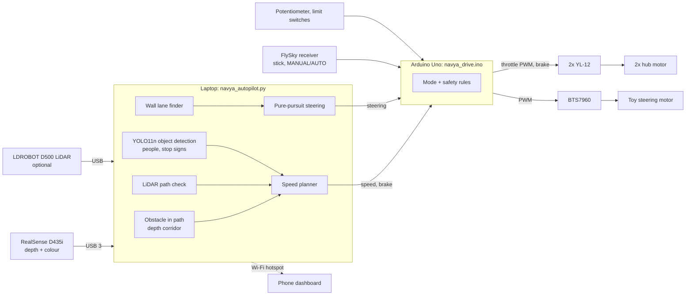
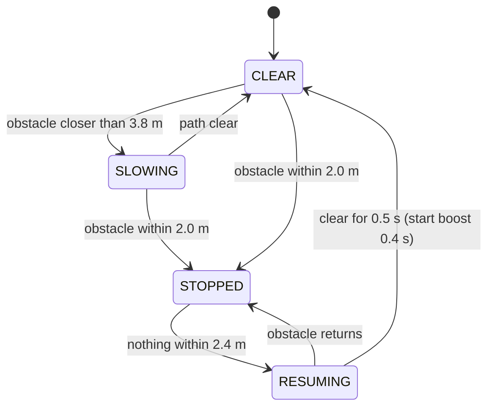

# Navya: project report

*Autonomous ride-on car, student project. Status as of 1 November 2026.*

## 1. Summary

Navya is a low-cost autonomous car built on a TZ-306 4x4 kids' ride-on car.
A laptop riding in the car reads an Intel RealSense D435i depth camera and decides how
fast to go. An Arduino Uno drives the two rear hub motors and enforces the safety rules.
A FlySky radio lets a person take over or stop the car at any moment.

**Demo 1 was shown on 30 October 2026.** The car drove straight down a corridor. It
slowed down and stopped by itself in front of an obstacle, and drove on by itself once
the obstacle was removed.

Since then we have added the software for object detection, a trip recorder, steering
and lane following, a LiDAR as a second sensor, a battery monitor, a phone dashboard
and a pre-flight check. All of it is tested offline. The parts that need the car are
waiting for their on-car tests (section 7).

## 2. Goal

| Stage | Goal | Status |
|---|---|---|
| Demo 1 | Drive straight; slow and stop for obstacles; resume when clear | **Done, shown 30 Oct** |
| Demo 2 | Follow the corridor by steering between the walls; react to people and stop signs | Software done; steering parts on order |
| Later | LiDAR mapping; wheel-speed feedback; onboard computer | Planned |

## 3. Hardware

| Part | Role |
|---|---|
| TZ-306 4x4 ride-on car (~31 kg with everything, 0.745 m wheelbase) | chassis |
| 2x 8" BLDC hub motor, 24 V 350 W | rear drive |
| 2x YL-12 brushless controller (24 V, 16 A) | one per hub motor; throttle, direction, brake |
| 2x 6S LiPo 22.2 V 5200 mAh | motor power |
| Arduino Uno | radio input, throttle and brake output, steering motor, safety |
| FlySky FS-CT6B + FS-R6B | manual driving, MANUAL/AUTO switch, emergency stop |
| Intel RealSense D435i | depth (obstacles, walls) and colour (object detection) |
| LDROBOT D500 LiDAR | 360° obstacle sensor (optional, laptop USB) |
| Laptop (Windows, Python, Intel Iris Xe) | all perception and planning |
| Toy's own steering motor + BTS7960 driver + potentiometer + 2 limit switches | steering (being fitted) |

**Constraints we work within**
- **Budget.** Only the parts needed to make the current car work are bought.
  The steering parts cost ₹2,302 from Robu.in.
- **Steering.** As decided by the professor, the toy's own steering motor and gearbox
  are kept. We add a motor driver and a position sensor instead of a new servo.
- **Arduino Uno pins** are now all in use. More inputs, such as wheel-speed sensors,
  need an Arduino Mega.

## 4. System design

The laptop sends the Arduino one short command line 30 times a second, for example
`D,<left>,<right>,<brake>,<steer>`. The Arduino answers with a status line 10 times a
second: mode, stick positions, PWM outputs, steering position and battery voltages.

### Obstacle detection

Each depth image is turned into 3D points in level floor coordinates, using the
camera's measured height (0.559 m) and tilt (14.6°). Only points inside a box in
front of the car count as obstacles:
- 0.45 m either side of the centre line;
- from 0.15 m above the floor (so the floor, tape and cables are ignored) up to 1.6 m;
- up to 4.5 m ahead.

The obstacle distance is the nearest 5% of those points. At least 800 points are
needed, so sensor noise is not mistaken for an obstacle. If most of the image has
no depth, something is right against the lens, and that counts as an obstacle.

### Speed planner

Speed falls smoothly from cruise to creep between 3.8 m and 2.0 m. The car stops at
2.0 m because it coasts about 0.9 m further, as measured on the first ground run. A
short throttle boost gets the 31 kg car moving again from a standstill.

### Extra perception (optional flags)

| Flag | What it adds |
|---|---|
| `--vision` | YOLO11n detects objects in the colour image, about 19 ms per frame on the Iris Xe GPU through OpenVINO. People make the car stop 1 m earlier, including people up to 0.3 m outside the path. At a stop sign the car stops, waits 3 s, then drives on. |
| `--lidar` | The LiDAR's nearest point in the same path also feeds the planner. The car obeys whichever sensor reports the nearer obstacle. |
| `--steer` | The lane is found from the corridor walls in the depth data, fitted with RANSAC. This works on shiny floors, where tape-strip detection failed. Pure-pursuit steers towards the lane centre 1.5 m ahead. |

Detection and the LiDAR can only make the car **more** careful. The depth check
always runs.

## 5. Safety design

Safety is layered, so that no single failure lets the car run on.

| Layer | Protection |
|---|---|
| Person with transmitter | Pulling the right stick back stops and brakes the car in any mode. The CH5 switch decides whether the laptop may drive at all. |
| Arduino | Stops and brakes if the radio signal is lost for 0.1 s, or the laptop is silent for 0.3 s (a crash or a pulled cable). |
| Arduino, steering | Never drives the steering past a limit switch. Turns the steering motor off if it stalls for 1.5 s or the potentiometer reading is invalid. |
| Laptop | Stops if depth frames stop for 0.5 s, if the LiDAR goes quiet with `--lidar`, or if the lens is covered. |
| Battery monitor | Warns at 22.2 V. Below 21.6 V for 3 s, it stops the car and keeps it stopped. |
| Pre-flight check | Checks every part before a run. Any FAIL blocks the launcher's drive option until it is confirmed. |

## 6. Software and tools

| Tool | Purpose |
|---|---|
| `Navya.bat` | One-click menu: pre-flight, drive modes, viewers, calibration |
| `preflight.py` | Checks packages, Arduino, radio, steering, batteries, camera calibration, LiDAR, SD card, phone link |
| Phone dashboard (`--phone`) | Live camera, depth and LiDAR views and status. Sliders tune speeds and distances during a run, and can save them to `config.py`. |
| Trip recorder (`--record`) | Camera, depth and LiDAR videos plus a telemetry CSV, saved to the SD card. `trip_report.py` summarises a trip. |
| Ask Navya | Ask a question about the camera picture from the phone. Uses free AI services (Gemini, with Groq as fallback). For display only: it never drives the car. |
| Calibration | `calibrate_camera.py` measures the camera height and tilt from the floor. `steering_calibrate.py` teaches the Arduino full left, straight and full right. |
| `test_logic.py` | 27 offline tests: obstacle maths on simulated depth images, speed planner, lane finder, steering, object rules, LiDAR packet decoding, battery guard, phone endpoints, AI fallback |
| GitHub Actions | Runs the tests and compiles the Arduino firmware on every push |

Every tunable number lives in one file, `autopilot/config.py`, with a comment saying
what it does.

## 7. Status

| Feature | Built | Tested offline | Tested on the car |
|---|---|---|---|
| Manual drive, MANUAL/AUTO, radio stop | yes | n/a | **yes** |
| Obstacle stop and resume (depth) | yes | yes | **yes (Demo 1)** |
| Phone dashboard | yes | yes | **yes (Demo 1)** |
| Wall lane finder (viewer) | yes | yes | viewer only, not steering yet |
| Object detection (`--vision`) | yes | yes | not yet |
| Trip recorder | yes | yes | not yet |
| Steering firmware v2 + calibration | yes | firmware compiles | waiting for parts |
| Lane following (`--steer`) | yes | yes | waiting for parts |
| Battery monitor | yes | yes | waiting for 4 resistors |
| LiDAR (`--lidar`, radar view) | yes | yes (simulated packets) | not yet |
| Live tuning, Ask Navya | yes | yes | Ask Navya needs free keys |

## 8. Lessons from Demo 1

| Problem seen | Cause | Fix |
|---|---|---|
| Car stopped too close to the obstacle | 31 kg coasts about 0.9 m after the brake | Stop distance raised to 2.0 m and slow-down to 3.8 m; cruise speed lowered |
| Slow to move off after the obstacle left | Long resume delay, and the car needs extra force to start | Resume delay cut to 0.5 s; 0.4 s start boost |
| A false obstacle at 1.8 m | Floor points just above the floor-clearance line | Clearance raised to 0.15 m; at least 800 points needed |
| Tape-lane detection failed | Reflections on the glossy floor | Lane found from the walls instead, using depth |
| Arduino upload failures | CH340 clone driver; Serial Monitor holding the port | Driver 3.5 pinned; the pre-flight check now warns about the open IDE |

## 9. Next steps

1. Fit the steering parts (BTS7960, potentiometer, limit switches, fuses).
   Upload firmware v2, calibrate, and measure the real steering angle.
2. First lane-following run in the corridor at creep speed, with `--record` on.
3. Mount and align the LiDAR, then run with `--lidar`.
4. Add the battery-monitor resistors (4 resistors on A4/A5).
5. Later: LiDAR mapping, wheel-speed feedback (needs an Arduino Mega), and moving
   the software to an onboard computer.

**What we need:** the steering parts order (₹2,302), corridor time for testing, and
later an Arduino Mega (about ₹1,000–1,500) for wheel-speed sensors.
