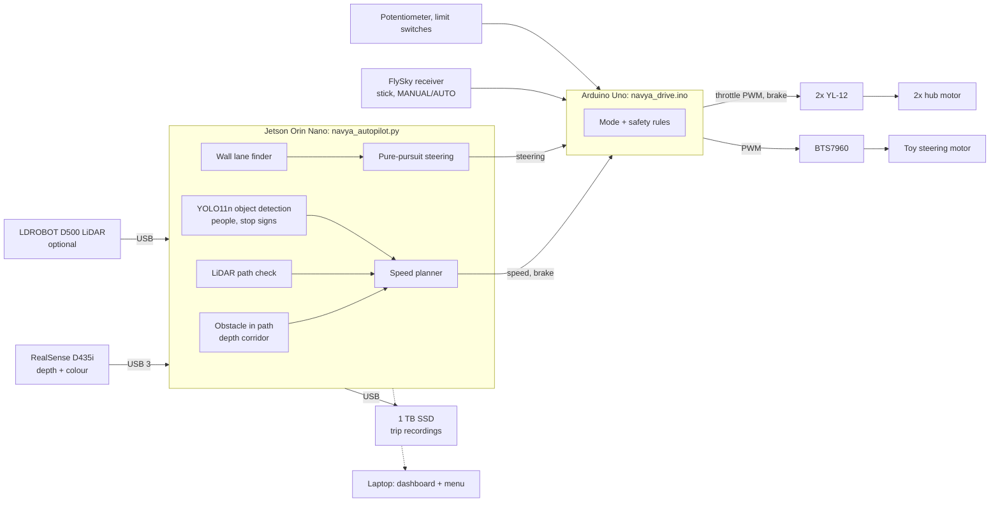
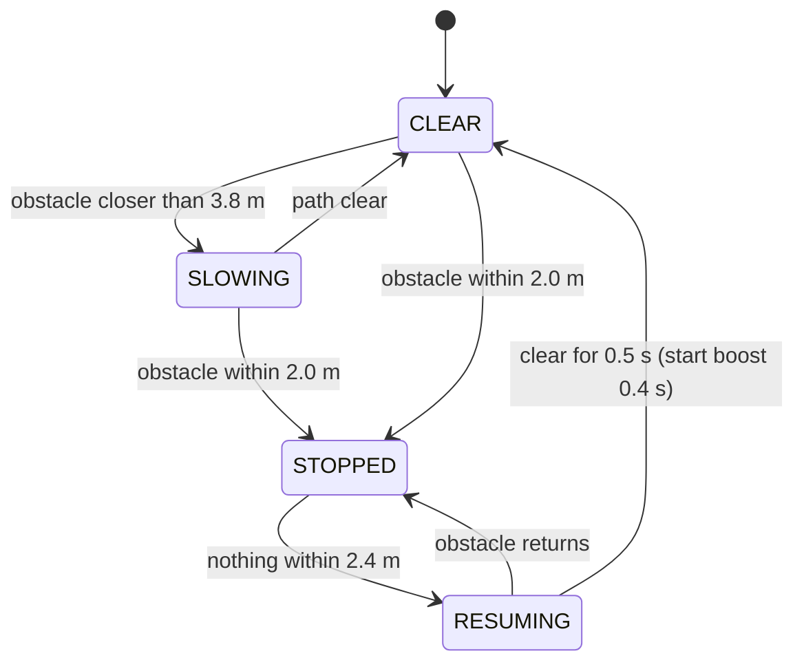

# Navya: project report

*Autonomous ride-on car, student project. Status as of 3 November 2026.*

## 1. Summary

Navya is a low-cost autonomous car built on a TZ-306 4x4 kids' ride-on car.
An onboard computer reads an Intel RealSense D435i depth camera (and a LiDAR) and
decides how fast to go. That computer is now an NVIDIA Jetson Orin Nano; until
2 November it was a laptop riding in the car. An Arduino Uno drives the two rear hub
motors and enforces the safety rules. A FlySky radio lets a person take over or stop
the car at any moment.

**Demo 1 was shown on 30 October 2026.** The car drove straight down a corridor. It
slowed down and stopped by itself in front of an obstacle, and drove on by itself once
the obstacle was removed.

Since then we have added the software for object detection, a trip recorder, steering
and lane following, a LiDAR as a second sensor, a battery monitor, a phone dashboard
and a pre-flight check.

**On 2 November we tested on the car.** The new firmware, the LiDAR, the camera
calibration, the safety stops and the trip recorder were checked with the wheels in the
air, then on the corridor floor. On the ground:
- for a box, the car braked at 1.97 m and came to rest **1.10 m** away (tape measure;
  the camera read 1.12 m);
- with object detection on, it recognised a person 5 m away, braked at 2.85 m and came
  to rest about **1.8–2.0 m** from them.

**On 3 November the software moved to the Jetson Orin Nano**, and passed a full bench
test on the car (wall power, motors unplugged):
- camera, Arduino, LiDAR, object detection and recording all ran together;
- object detection runs on the Jetson's GPU (TensorRT): 23 ms per image;
- the LiDAR problem from the laptop ("lost" several times a minute) did not occur at all
  in 4.5 minutes;
- trips record to a 1 TB SSD;
- the laptop is now only the screen: one double-click finds the Jetson on the Wi-Fi and
  opens its menu and live dashboard.

Driving with the Jetson waits for a 12 V step-down converter (ordered) to power it from a
LiPo. The full wiring is documented in `docs/Navya_wiring.pdf`.

Section 7 lists what is tested; section 8 lists what we found and fixed.

## 2. Goal

| Stage | Goal | Status |
|---|---|---|
| Demo 1 | Drive straight; slow and stop for obstacles; resume when clear | **Done, shown 30 Oct** |
| Demo 2 | Follow the corridor by steering between the walls; react to people and stop signs | Reacting to people tested on the car; steering parts on order |
| Onboard computer | Run everything on the car itself, laptop only as a screen | **Jetson set up and bench-tested 3 Nov**; needs its power converter to drive |
| Later | LiDAR mapping; wheel-speed feedback | Planned |

## 3. Hardware

| Part | Role |
|---|---|
| TZ-306 4x4 ride-on car (~31 kg with everything, 0.745 m wheelbase) | chassis |
| 2x 8" BLDC hub motor, 24 V 350 W | rear drive |
| 2x YL-12 brushless controller (24 V, 16 A) | one per hub motor; throttle, direction, brake |
| 2x 6S LiPo 22.2 V 5200 mAh | motor power |
| Arduino Uno | radio input, throttle and brake output, steering motor, safety |
| FlySky FS-CT6B + FS-R6B | manual driving, MANUAL/AUTO switch, emergency stop |
| Intel RealSense D435i | depth (obstacles, walls) and colour (object detection); rigid mount at the front, 0.55 m high, 4.4° down |
| LDROBOT D500 LiDAR | 360° obstacle sensor (optional, USB); on the dashboard bar, above the camera |
| NVIDIA Jetson Orin Nano Super (JetPack 6.2) | onboard computer since 3 Nov: all perception and planning, object detection on its GPU; camera, Arduino and LiDAR straight into its USB ports |
| Samsung T7 SSD, 1 TB | trip recordings on the Jetson |
| Laptop (Windows) | the screen: dashboard in the browser, menu over Wi-Fi (SSH). Also still able to drive the car on its own, as on 2 Nov |
| Toy's own steering motor + BTS7960 driver + potentiometer + 2 limit switches | steering (being fitted) |

**Constraints we work within**
- **Budget.** Only the parts needed to make the current car work are bought.
  The steering parts cost ₹2,302 from Robu.in.
- **Steering.** As decided by the professor, the toy's own steering motor and gearbox
  are kept. We add a motor driver and a position sensor instead of a new servo.
- **Arduino Uno pins** are now all in use. More inputs, such as wheel-speed sensors,
  need an Arduino Mega.

## 4. System design

The Jetson sends the Arduino one short command line 30 times a second, for example
`D,<left>,<right>,<brake>,<steer>`. The Arduino answers with a status line 10 times a
second: mode, stick positions, PWM outputs, steering position and battery voltages.
The link runs at 250000 baud, a speed the Uno's 16 MHz clock produces exactly. Both
ends throw away any line that arrives damaged.

### Obstacle detection

Each depth image is turned into 3D points in level floor coordinates, using the
camera's measured height (0.554 m) and tilt (4.4° down). Only points inside a box in
front of the car count as obstacles:
- 0.45 m either side of the centre line;
- from 0.15 m above the floor (so the floor, tape and cables are ignored) up to 1.6 m;
- up to 4.5 m ahead.

The obstacle distance is the nearest 5% of those points. At least 800 points are
needed, so sensor noise is not mistaken for an obstacle. If most of the image has
no depth, something is right against the lens, and that counts as an obstacle.

### Speed planner

Speed falls smoothly from cruise to creep between 3.8 m and 2.0 m. The car brakes at
2.0 m because it rolls about 0.85 m further (measured again on 2 November), so it
comes to rest about 1.1 m from the obstacle. A short throttle boost gets the 31 kg car
moving again from a standstill.

### Extra perception (optional flags)

| Flag | What it adds |
|---|---|
| `--vision` | YOLO11n detects objects in the colour image: 23 ms per frame on the Jetson's GPU through TensorRT (19 ms on the laptop's Iris Xe GPU through OpenVINO). People make the car stop 1 m earlier, including people up to 0.3 m outside the path. At a stop sign the car stops, waits 3 s, then drives on. |
| `--lidar` | The LiDAR's nearest point in the same path also feeds the planner. The car obeys whichever sensor reports the nearer obstacle. |
| `--steer` | The lane is found from the corridor walls in the depth data, fitted with RANSAC. This works on shiny floors, where tape-strip detection failed. Pure-pursuit steers towards the lane centre 1.5 m ahead. |

Detection and the LiDAR can only make the car **more** careful. The depth check
always runs.

## 5. Safety design

Safety is layered, so that no single failure lets the car run on.

| Layer | Protection |
|---|---|
| Person with transmitter | Pulling the right stick back stops and brakes the car in any mode, even while the laptop is asking it to drive (tested: brake on in all 283 readings). The CH5 switch decides whether the laptop may drive at all. |
| Arduino | Stops and brakes if the radio signal is lost for 0.1 s, or the laptop is silent for 0.3 s, for example a crash or a pulled cable (tested: motors off after 0.26 s). |
| Arduino, steering | Never drives the steering past a limit switch. Turns the steering motor off if it stalls for 1.5 s or the potentiometer reading is invalid. |
| Jetson (or laptop) | Stops if depth frames stop for 0.5 s, if the LiDAR goes quiet with `--lidar`, or if the lens is covered. |
| Battery monitor | Warns at 22.2 V. Below 21.6 V for 3 s, it stops the car and keeps it stopped. |
| Pre-flight check | Checks every part before a run, including the laptop's own battery. Any FAIL blocks the launcher's drive option until it is confirmed. |

## 6. Software and tools

| Tool | Purpose |
|---|---|
| `Navya Jetson.bat` | On the laptop, one double-click: finds the Jetson on the Wi-Fi, opens the Navya menu on it, and opens the dashboard when a drive starts |
| `Navya.bat` / `navya.sh` | The same menu on the laptop / on the Jetson: pre-flight, drive modes, viewers, calibration |
| `preflight.py` | Checks packages, power (laptop battery or Jetson power mode), Arduino, radio, steering, batteries, camera calibration, LiDAR, SSD, object detection, network |
| Dashboard (`--phone`) | Live camera, depth and LiDAR views and status in any browser on the same Wi-Fi (now the laptop's). Sliders tune speeds and distances during a run, and can save them to `config.py`. |
| Trip recorder (`--record`) | Camera, depth and LiDAR videos plus a telemetry CSV, saved to the Jetson's SSD (or an SD card on the laptop). `trip_report.py` summarises a trip. |
| Jetson setup | `jetson/setup_jetson.sh` (Python with GPU PyTorch, RealSense), `export_models.py` (TensorRT), `jetson/build_ch341.sh` (Arduino USB driver) |
| Wiring document | `docs/Navya_wiring.pdf`, generated by `docs/wiring/make_wiring_pdf.py` |
| Ask Navya | Ask a question about the camera picture from the phone. Uses free AI services (Gemini, with Groq as fallback). For display only: it never drives the car. |
| Calibration | `calibrate_camera.py` measures the camera height and tilt from the floor. `steering_calibrate.py` teaches the Arduino full left, straight and full right. |
| `test_logic.py` | 27 offline tests: obstacle maths on simulated depth images, speed planner, lane finder, steering, object rules, LiDAR packet decoding, battery guard, phone endpoints, AI fallback |
| GitHub Actions | Runs the tests and compiles the Arduino firmware on every push |

Every tunable number lives in one file, `autopilot/config.py`, with a comment saying
what it does.

## 7. Status

| Feature | Built | Tested offline | Tested on the car |
|---|---|---|---|
| Manual drive, MANUAL/AUTO, radio stop | yes | n/a | **yes** (again with firmware v2, 2 Nov) |
| Stick-back stop over the laptop; stop when the laptop is silent | yes | yes | **yes (2 Nov, wheels in the air)** |
| Obstacle stop and resume (depth) | yes | yes | **yes**: brakes at 1.97 m, rests 1.10 m from a box (2 Nov) |
| Phone dashboard | yes | yes | **yes (Demo 1)** |
| Wall lane finder (viewer) | yes | yes | viewer only, not steering yet |
| Object detection (`--vision`) | yes | yes | **yes**: person seen at 5 m, rests 1.8–2.0 m away (2 Nov); "drive on after the person leaves" still to test on the ground |
| Trip recorder | yes | yes | **yes (2 Nov)**; the numbers below come from its recordings |
| Camera calibration | yes | yes | **yes**: camera and tape agree within 2 cm |
| LiDAR (`--lidar`, radar view) | yes | yes | mounted and aligned (camera and LiDAR agree within 6 cm on a wall). On the laptop the full program sometimes reported it "lost"; **on the Jetson: 0 times in 4.5 min (3 Nov)**. Not yet driven on the ground |
| Jetson as onboard computer | yes | yes | **bench test on the car passed (3 Nov)**: all sensors, detection, recording, dashboard; driving waits for its power converter |
| Steering firmware v2 + calibration | yes | firmware compiles | firmware v2 on the car; steering waiting for parts |
| Lane following (`--steer`) | yes | yes | waiting for parts |
| Battery monitor | yes | yes | waiting for 4 resistors |
| Live tuning, Ask Navya | yes | yes | Ask Navya needs free keys |

## 8. Lessons from Demo 1

| Problem seen | Cause | Fix |
|---|---|---|
| Car stopped too close to the obstacle | 31 kg coasts about 0.9 m after the brake | Stop distance raised to 2.0 m and slow-down to 3.8 m; cruise speed lowered |
| Slow to move off after the obstacle left | Long resume delay, and the car needs extra force to start | Resume delay cut to 0.5 s; 0.4 s start boost |
| A false obstacle at 1.8 m | Floor points just above the floor-clearance line | Clearance raised to 0.15 m; at least 800 points needed |
| Tape-lane detection failed | Reflections on the glossy floor | Lane found from the walls instead, using depth |
| Arduino upload failures | CH340 clone driver; Serial Monitor holding the port | Driver 3.5 pinned; the pre-flight check now warns about the open IDE |

### Found and fixed in the on-car tests (2 November)

| Problem seen | Cause | Fix |
|---|---|---|
| The Arduino stopped working whenever it was plugged into another USB port | Windows installed the newer CH340 driver (3.9) for each new port, and the clone chip fails with it | The 3.9 driver was removed from Windows; only 3.5 remains |
| About 15 damaged Arduino messages a minute, causing short false brake-and-restart jerks | At 115200 baud the Uno's clock is 2% off, and the clone USB chip drops bytes | Link moved to 250000 baud (exact): 0 damaged in 1,200 lines. Damaged lines are now ignored and counted |
| The brake flickered on with the stick untouched | The stick's centre had drifted from ~1464 to ~1410 µs, right at the 1400 µs stop line | Stop line lowered to 1300 µs; a full pull back reads 1112–1250 µs |
| The camera ran at USB 2 and sometimes stopped sending | It shared a cheap USB 2 hub; after re-plugging it can get stuck | Camera straight into the laptop (now USB 3.2); the program resets a stuck camera by itself |
| The LiDAR saw the camera 0.37 m ahead | Both were at the same height | LiDAR raised above the camera |
| After a few hard stops the floor counted as an obstacle | The taped camera mount nodded forward 8° on braking | Camera mounted rigidly, then recalibrated |
| The laptop went to sleep in the middle of testing | The hub's charging pass-through could not keep up; the battery reached 4% | Charge the laptop directly; the pre-flight check now fails below 20% battery |

### Found and fixed moving to the Jetson (3 November)

| Problem seen | Cause | Fix |
|---|---|---|
| The Arduino got no serial port on the Jetson | NVIDIA's JetPack kernel has no driver for the CH340 USB chip | Built the standard Linux `ch341` driver for this kernel and installed it (`jetson/build_ch341.sh`) |
| With that driver, the link returned the same line over and over | Reading one byte at a time misbehaves with this driver | The link now reads everything that has arrived and splits lines itself: 0 damaged lines |
| The programs took the LiDAR's port for the Arduino | With the Arduino invisible, the only USB-serial port left was the LiDAR's | The LiDAR's adapter type is never chosen as the Arduino |
| The camera would not start | It was connected through a USB-C dock | Plain cable straight into a Jetson port: USB 3.2, calibration still matches |
| GPU PyTorch did not work, and later broke again | The installed PyTorch was not NVIDIA's Jetson build; an automatic install pulled in an incompatible numpy | Navya has its own Python environment with NVIDIA's build and pinned versions; automatic installs are switched off |
| The laptop could not reach the Jetson on college Wi-Fi | College Wi-Fi blocks device-to-device traffic | Both on a phone hotspot or the laptop's hotspot; the laptop finds the Jetson by itself |

## 9. Next steps

1. **Power the Jetson from the car:** LiPo → 5 A fuse → 12 V step-down (≥ 5 A) → Jetson
   (planned wiring on page 4 of `docs/Navya_wiring.pdf`). Then the wheels-up test and the
   first drive with the Jetson.
2. Finish the person test on the ground: the car must drive on once the person steps aside.
3. Run with `--lidar` on the ground (with the Jetson, where the LiDAR is stable).
4. Add the battery-monitor resistors (4 resistors on A4/A5). Today nothing warns
   before the LiPos run low. With the Jetson on a LiPo, this matters more.
5. Fit the steering parts (BTS7960, potentiometer, limit switches, fuses), calibrate,
   and measure the real steering angle.
6. First lane-following run in the corridor at creep speed, with `--record` on.
7. Later: LiDAR mapping and wheel-speed feedback (needs an Arduino Mega).

**What we need:** the 12 V step-down converter (ordered), the steering parts order
(₹2,302), 4 resistors, corridor time for testing, and later an Arduino Mega (about
₹1,000–1,500) for wheel-speed sensors.
